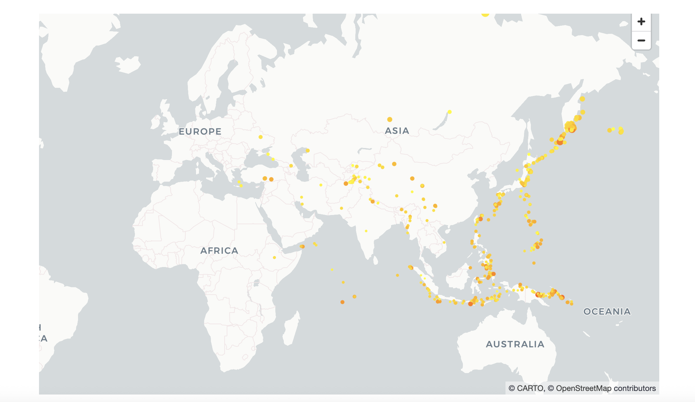
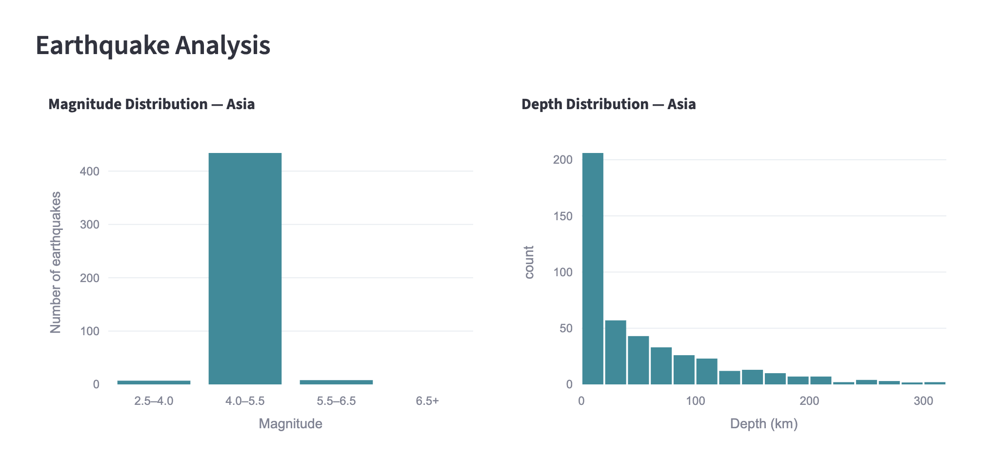
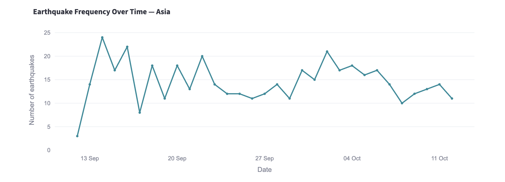

SeismoDex 

SeismoDex is a Python project I built to explore earthquake data and look at how seismic activity varies around the world.

The website uses earthquake data from the USGS to display recent seismic activity on an interactive map, alongside statistics and graphs that help explore the data.

**What it does**

Displays earthquake locations on an interactive world map, with information about each earthquake available on hover
Lets users explore different regions, from individual continents to the whole world
Filters earthquakes by minimum magnitude and maximum depth
Calculates statistics for the selected region, including the number of earthquakes, strongest magnitude, average magnitude and deepest event
Visualises earthquake magnitude, depth and frequency over time using interactive graphs
Includes a table to explore the raw earthquake data

I built the application using Python, with the following libraries:

Pandas – for cleaning, filtering and analysing earthquake data.
GeoPandas – for working with geographical boundary data.
PyDeck – for displaying earthquake locations on an interactive map.
Plotly – for creating interactive graphs.
Streamlit – for building the website and its interactive controls.
NumPy – for numerical operations.
Data sources
USGS Earthquake Data – provides earthquake records from the previous month, including magnitude, location, depth and time.
Natural Earth – provides country boundary data for the geographical features.

Running the project locally

You'll need Python 3 installed.

1. Install the required libraries

python3 -m pip install streamlit pandas geopandas pydeck plotly matplotlib numpy

2. Run the application

streamlit run app.py

Streamlit will provide a local URL where you can open the website in your browser.

## Screenshots

### Interactive earthquake map

### Earthquake analysis

